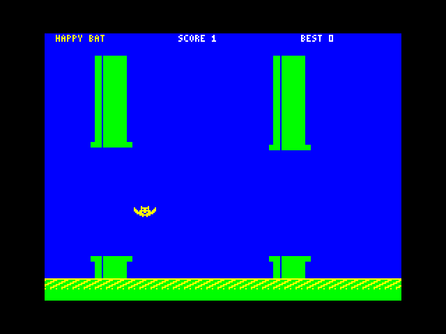
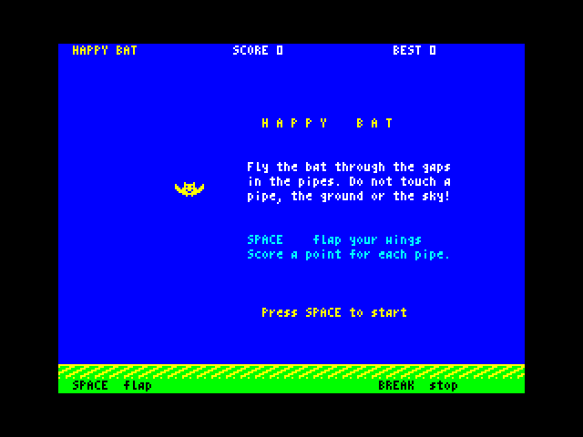
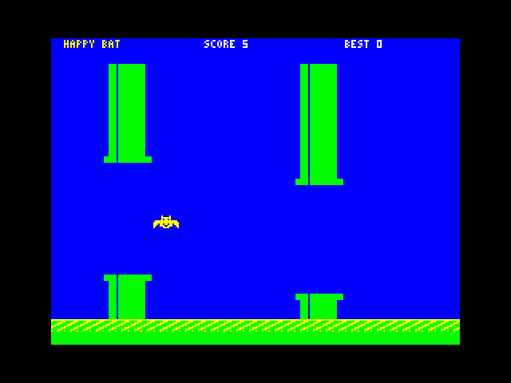
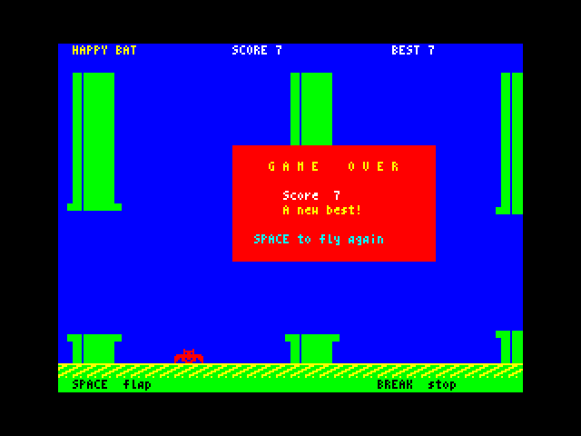

# Happy Bat

 

*A Flappy Bird-style game for the 48K ZX Spectrum running OpticOS v1.0.1.*

Fly the bat through the gaps in the pipes. Each pipe you pass scores a point, and if you touch a pipe, the ground or the sky, the game ends. The gaps start wide and the pipes far apart, then both close up as your score rises. Happy Bat keeps your best score until the program is run again.

It is written mostly in **OpticBASIC** (no line numbers, named procedures, no GOTO or GOSUB), with 1,095 bytes of Z80 machine code for the parts that have to be fast.

## What you need

Happy Bat runs on **[OpticOS](https://github.com/brixham99/OpticOS) v1.0.1**, a clean-room replacement ROM for the 48K ZX Spectrum. Get the ROM from the [OpticOS releases](https://github.com/brixham99/OpticOS/releases). It is not included here. Happy Bat will not run on the Sinclair ROM.

Any emulator that takes a custom 48K ROM will run it. For example, with [Fuse](https://fuse-emulator.sourceforge.net/):

    fuse --machine 48 --rom-48 opticos.rom --tape happybat.tap

The game has been tested in Fuse 1.6 with tape traps both on and off.

## Loading

Type `LOAD ""` and press ENTER, then start the tape if your emulator does not start it for you. The program runs by itself once it has loaded. It sets `CLEAR 59999`, loads its machine code (`hbcode`, the second block on the tape), and shows the title screen. `happybat.tzx` holds the same two blocks as `happybat.tap`.

## Controls

| Key | |
|---|---|
| **SPACE** | start, flap, play again |
| **BREAK** (CAPS SHIFT + SPACE) | stop the program |

## Screenshots

| | |
|---|---|
|  |  |
|  |  |

These were all taken in Fuse running the OpticOS v1.0.1 ROM.

## How BASIC and machine code share the work

**OpticBASIC** (`happybat.bas`) runs the game:
- the title screen;
- when each pipe appears and where its gap is;
- how the gap (78 lines at first, down to 52) and the spacing (128 pixels at first, down to 96) tighten with the score;
- the score and best score;
- the game-over box and restarting.

**Machine code** (`happybat.asm`, at 60000–61094) does everything that touches the screen each step. It:
- scrolls the ground;
- moves and draws up to four pipes;
- reads SPACE;
- applies gravity and the flap;
- draws the bat and checks whether it has hit something.

OpticBASIC's `CALL` and `USR` pass no register values, so BASIC POKEs a small parameter block at 60009–60019. `r% = USR 60003` runs one step and returns 0 (flying), 1 (crashed) or 2 (a pipe passed). The BASIC game loop is only four statements, and the game runs at about 23 steps a second.

[happybat_listing.md](happybat_listing.md) has the full details:
- the interface and memory map;
- the OpticBASIC limits met along the way;
- the test results;
- both sources in full;
- the machine code as a type-in listing for the OpticOS manual.

## Files

| | |
|---|---|
| `happybat.bas`, `happybat.asm` | the two sources, both fully commented |
| `hbloader.bas` | a type-in OpticBASIC loader for the machine code, with checksums; it saves `hbcode` to tape |
| `happybat.tap`, `happybat.tzx` | the game on tape, saved by the OpticOS ROM's own `SAVE` |
| `happybat_listing.md` | the full listing and notes |
| `build/` | the assembled code (`hbcode.bin`, `hbcode.sym`), a hex dump, the manual section and the test results |
| `shots/` | the screenshots |
| `tools/` | the tape builder, the loader and listing makers, rig tests and Fuse scripts |

## Building and testing

You need [pasmo](https://pasmo.speccy.org/), Python 3 and a checkout of the [OpticOS repository](https://github.com/brixham99/OpticOS), for its Z80 test rig and Fuse helpers, with the v1.0.1 ROM at `build/opticos.rom` in it. Set `OPTICOS_REPO` to that checkout; it defaults to `../OpticOS`.

    pasmo --bin happybat.asm build/hbcode.bin build/hbcode.sym
    python3 tools/mkloader.py         # hbloader.bas, hex dump, manual section
    python3 tools/mktape.py           # happybat.tap/.tzx, saved by the ROM itself
    python3 tools/mklisting.py        # happybat_listing.md
    python3 tools/test_happybat.py    # game tests in the rig
    python3 tools/test_loader.py      # the type-in loader gives the same bytes
    python3 tools/t_soak.py           # 40 games in a row

This is original, clean-room work. It contains no Sinclair ROM code and calls none.

## Licence

Code is under the MIT licence. Artwork and text are under [CC BY 4.0](https://creativecommons.org/licenses/by/4.0/). See [LICENSE](LICENSE).

Copyright (c) 2026 Optica Technology Design.
